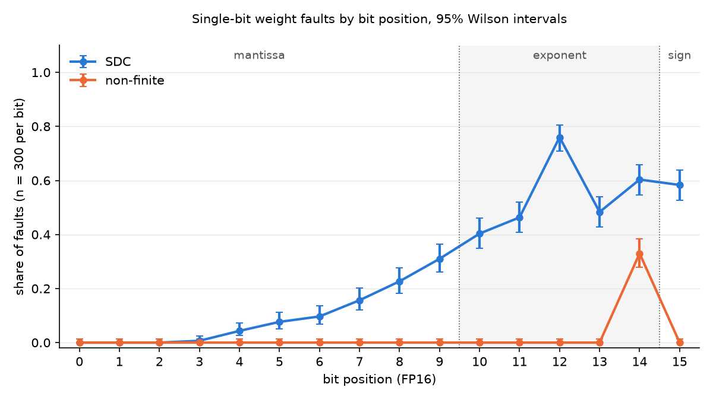

# MNIST bit-flip study (week of Nov 4 – Nov 9, 2026)

A short guide for people. The full step-by-step plan, written for AI agents, is in [`plan-mnist-week1.md`](plan-mnist-week1.md).

**Status (Nov 8):** the official runs are done and every check passed (results below). Still to do: Tony's fault-model paragraph and four short answers. The plan's work log has the details. **Due:** Monday, Nov 9.

## What we're doing

Computers store a neural network's weights as bits in memory. A hardware fault can flip one of those bits, changing a weight. We want to know which bits matter: does a flip break the network visibly, change its answers without warning, or do nothing?

This week we test that on a small digit-recognition network before trying it on diffusion models next week.

1. Train a small network to recognize handwritten digits (MNIST).
2. Store its weights as 16-bit floating point numbers (FP16), the format diffusion models usually use.
3. Pick 300 weights at random (150 from each layer). For each one, flip each of its 16 bits, one at a time, and check how the network's answers on 10,000 test images change. That's 4,800 tests.
4. Put every test into one of three groups:
   - **Non-finite:** the network outputs infinity or "not a number". Broken, but easy to detect.
   - **Silent data corruption:** the outputs look normal, but at least one answer changed. The dangerous case.
   - **Masked:** no answer changed.
5. Count the groups for each bit position and plot the results.

After every test the original bit is put back and checked, so each test starts from the same unchanged network.

## How an FP16 number is stored

| Bits | Part | What it does |
|---|---|---|
| 15 | Sign | Positive or negative |
| 14 – 10 | Exponent | Sets the size (roughly, the power of 2) |
| 9 – 0 | Mantissa | Sets the precise digits |

Bit 0 is the rightmost bit.

## Choices we made

| Choice | What we picked |
|---|---|
| Master seed (the one number all randomness comes from) | `20261104` |
| Network | 784 inputs → 128 hidden units → 10 outputs |
| Training | Adam optimizer, 10 passes over the training data, on the Mac's CPU |
| Input scaling | Standard MNIST normalization (to confirm with Aneesh and Parnian) |
| Where the faults are tested | The Mac's GPU, in FP16 |
| Allowed accuracy drop from switching to FP16 | At most 0.1 percentage points (to confirm with Parnian) |
| Plot format | PNG |

## Why the seed matters

Every random choice (training, which weights get picked) comes from one master seed, through a separate stream for each purpose. Anyone with the seed, the code and the same library versions gets exactly the same network, the same 300 weights and the same results. To prove it, we run the whole test twice and check the result files are identical.

## The machine

All of this week's results come from Tony's MacBook (Apple M5 Pro, macOS 26.6.2). They're a separate set from the diffusion results, which come from the Windows PC with an RTX 5090.

## What gets handed in

- This repository, with the master seed, library versions and the commands to reproduce everything.
- The list of the 300 chosen weights.
- The results file: one row for each of the 4,800 tests.
- Confirmation that two runs gave identical files.
- A 16-row table for a single weight, going through all its bits.
- The per-bit table and plot.
- A paragraph describing the fault model, and four short answers (written by Tony).

## How to run it

On a Mac with Apple silicon. From the repo root, once:

```bash
python3.12 -m venv .venv
source .venv/bin/activate
pip install -r mnist/requirements-mac.txt
cd mnist
```

Then, from `mnist/`:

```bash
pytest tests/ -q                                                    # bit-flip and statistics tests
python src/mnist_fault.py train --run-name train_a                  # train the network
python src/mnist_fault.py train --run-name train_b                  # train again...
python src/mnist_fault.py compare logs/train_a logs/train_b         # ...and check both came out identical
python src/mnist_fault.py one-weight --model logs/train_a/model_fp32.pt --run-name one_weight
python src/mnist_fault.py campaign --model logs/train_a/model_fp32.pt --run-name campaign_a
python src/mnist_fault.py campaign --model logs/train_a/model_fp32.pt --run-name campaign_b
python src/mnist_fault.py compare logs/campaign_a logs/campaign_b   # the two campaigns must match
python src/mnist_fault.py summarize logs/campaign_a                 # per-bit tables and plot
```

Everything takes under a minute on the M5 Pro. Results land in `logs/`: `one_weight/one_weight.csv`, and in `campaign_a/` the files `chosen_elements.csv`, `faults.csv`, `per_bit.csv`, `per_field.csv` and `per_bit.png`.

## Results (official run)

**Run:** Nov 8, 2026, at commit `757c67a` with a clean working tree.
**Machine:** Tony's MacBook (Apple M5 Pro, macOS 26.6.2); the faults were tested on the Mac's GPU through PyTorch's MPS backend.
**Software:** Python 3.12.16, torch 2.15.0, torchvision 0.29.2, numpy 2.5.4 (full list in [`requirements-mac.txt`](requirements-mac.txt)).
**Master seed:** `20261104`.

This is a separate result set from the CIFAR-10 runs on the Windows PC.

- **Accuracy on all 10,000 test images:** 97.43% in every setting: FP32 on the CPU, FP32 on the Mac GPU, and FP16 on the Mac GPU. Switching to FP16 changed it by 0.0 points.
- **Repeatability:**
  - Two training runs gave identical weights (parameter SHA-256 `4ee3056c93ccf1a2a56df7879c3f79464253091babe1bf913ff287c5531db923`).
  - **Two campaigns with the same seed wrote byte-identical result files** ([`logs/campaign_compare.json`](logs/campaign_compare.json)):
    - `chosen_elements.csv`: SHA-256 `80e9c4669122e5da5a9a056083b20bce5988c57ca7a5282c87907bb095ba50ce`
    - `faults.csv`: SHA-256 `dae4fa9f643e6b19930a0fade5436df38005e17d2cbbea61d2d22de5ee52ab2e`
- **All 4,800 faults:** 3,437 masked, 1,264 silent data corruption (SDC), 99 non-finite.

**Per bit** (300 faults each; shares with 95% Wilson intervals, from [`per_bit.csv`](logs/campaign_a/per_bit.csv)):

| Bit | Field | Masked | SDC | Non-finite | SDC share [95% CI] | Non-finite share [95% CI] |
|---|---|---|---|---|---|---|
| 0 | mantissa | 300 | 0 | 0 | 0.0% [0.0, 1.3] | 0.0% [0.0, 1.3] |
| 1 | mantissa | 300 | 0 | 0 | 0.0% [0.0, 1.3] | 0.0% [0.0, 1.3] |
| 2 | mantissa | 300 | 0 | 0 | 0.0% [0.0, 1.3] | 0.0% [0.0, 1.3] |
| 3 | mantissa | 298 | 2 | 0 | 0.7% [0.2, 2.4] | 0.0% [0.0, 1.3] |
| 4 | mantissa | 287 | 13 | 0 | 4.3% [2.5, 7.3] | 0.0% [0.0, 1.3] |
| 5 | mantissa | 277 | 23 | 0 | 7.7% [5.2, 11.2] | 0.0% [0.0, 1.3] |
| 6 | mantissa | 271 | 29 | 0 | 9.7% [6.8, 13.5] | 0.0% [0.0, 1.3] |
| 7 | mantissa | 253 | 47 | 0 | 15.7% [12.0, 20.2] | 0.0% [0.0, 1.3] |
| 8 | mantissa | 232 | 68 | 0 | 22.7% [18.3, 27.7] | 0.0% [0.0, 1.3] |
| 9 | mantissa | 207 | 93 | 0 | 31.0% [26.0, 36.4] | 0.0% [0.0, 1.3] |
| 10 | exponent | 179 | 121 | 0 | 40.3% [34.9, 46.0] | 0.0% [0.0, 1.3] |
| 11 | exponent | 161 | 139 | 0 | 46.3% [40.8, 52.0] | 0.0% [0.0, 1.3] |
| 12 | exponent | 72 | 228 | 0 | 76.0% [70.9, 80.5] | 0.0% [0.0, 1.3] |
| 13 | exponent | 155 | 145 | 0 | 48.3% [42.7, 54.0] | 0.0% [0.0, 1.3] |
| 14 | exponent | 20 | 181 | 99 | 60.3% [54.7, 65.7] | 33.0% [27.9, 38.5] |
| 15 | sign | 125 | 175 | 0 | 58.3% [52.7, 63.8] | 0.0% [0.0, 1.3] |

**By field** (from [`per_field.csv`](logs/campaign_a/per_field.csv)), masked / SDC / non-finite:
- sign (300 faults): 125 / 175 / 0
- exponent (1,500): 587 / 814 / 99
- mantissa (3,000): 2,725 / 275 / 0

The same 300 weights are reused for every bit, so faults within a field aren't independent. The grouped intervals in `per_field.csv` treat them as if they were.



**One weight through all 16 bits:** [`one_weight.csv`](logs/one_weight/one_weight.csv). The weight is `fc1.weight[33719]` (hidden unit 43, pixel 7), value 0.0166.

**Result files:** [`chosen_elements.csv`](logs/campaign_a/chosen_elements.csv) (the 300 weights) and [`faults.csv`](logs/campaign_a/faults.csv) (one row per fault). Every run folder has a `run.json` with the commit, seeds, machine, library versions, data and model hashes, and timings.

**Choices the team doc leaves open** (full list in section 5 of the plan):
- The baseline for comparison is the fault-free FP16 network on the Mac GPU.
- Inputs are normalized with mean 0.1307 and std 0.3081.
- The device that runs the network can affect whether a large fault ends as non-finite or SDC, so these results are specific to the Mac GPU.

## Who does what

- **Tony:** commits and pushes; writes the fault-model paragraph and short answers; confirms the open choices with Aneesh and Parnian.
- **Claude (AI assistant):** writes the code, runs the checks, supplies the numbers and keeps [`plan-mnist-week1.md`](plan-mnist-week1.md) up to date.

## Sources

- Team Google Doc, "Proposal" tab, section *Tasks (Nov 4 – Nov 9)*. It has the final say on the rules.
- [`handoff-mnist-week1.md`](handoff-mnist-week1.md): the earlier handoff note.
