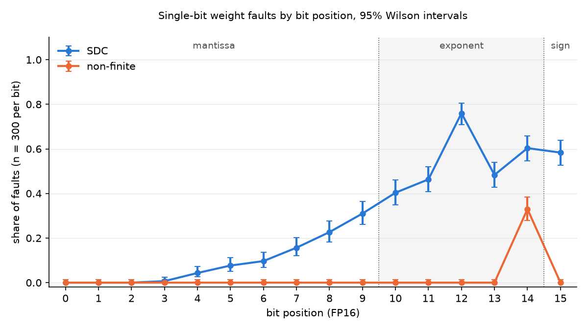

# MNIST bit-flip study: results and answers (Nov 9, 2026)

The MNIST hand-in for Nov 4 – 9, 2026: results, the fault-model paragraph and the four short answers. All results come from the official runs at commit `757c67a`.

## Setup

| | |
|---|---|
| Network | Fully connected, 784 → 128 (ReLU) → 10 |
| Training | CPU, FP32; Adam (learning rate 0.001), batch size 64, 10 epochs, cross-entropy loss |
| Input scaling | `(pixel / 255 − 0.1307) / 0.3081` |
| Where faults were tested | FP16 on the Mac GPU (Apple M5 Pro, PyTorch MPS backend) |
| Faults | 150 elements from `fc1.weight` (128 × 784) and 150 from `fc2.weight` (10 × 128), each with all 16 bits flipped one at a time: 4,800 single-bit faults. Biases not faulted. |
| Reference | The same network in FP16 with no fault, on all 10,000 MNIST test images |
| Classes | Checked in this order: non-finite (any output is inf or NaN), silent data corruption or SDC (all outputs finite, at least one prediction differs from the reference), masked (every prediction equals the reference) |

## 1. Repository and reproduction

- **Repository:** https://github.com/Tonylai2789/bitflip-diffusion (this work is in `mnist/`).
- **Code version:** every official run was made at commit `757c67a` with a clean working tree.
- **Master seed:** `20261104`, split into a separate stream for each purpose with numpy `SeedSequence`.
- **Machine:** Apple M5 Pro, macOS 26.6.2.
- **Software:** Python 3.12.16, torch 2.15.0, torchvision 0.29.2, numpy 2.5.4. Pinned in [`requirements-mac.txt`](requirements-mac.txt).
- **Commands that reproduce every table**, run from `mnist/` after `pip install -r requirements-mac.txt`:

  ```bash
  python src/mnist_fault.py train --run-name train_a
  python src/mnist_fault.py one-weight --model logs/train_a/model_fp32.pt --run-name one_weight
  python src/mnist_fault.py campaign --model logs/train_a/model_fp32.pt --run-name campaign_a
  python src/mnist_fault.py summarize logs/campaign_a
  ```

  The full list, including the repeat runs and the tests, is in [`README.md`](README.md#how-to-run-it).

## 2. Accuracy without faults

| Setting | Accuracy on 10,000 test images |
|---|---|
| FP32, CPU | 97.43% |
| FP32, Mac GPU | 97.43% |
| FP16, Mac GPU (the reference) | 97.43% |

Switching to FP16 changed accuracy by 0.0 percentage points (the margin we set was 0.1 points).

## 3. Identical reruns

**Two runs of the campaign with the same master seed gave byte-identical result files** ([`logs/campaign_compare.json`](logs/campaign_compare.json)):

| File | SHA-256 (both runs) |
|---|---|
| `chosen_elements.csv` | `80e9c4669122e5da5a9a056083b20bce5988c57ca7a5282c87907bb095ba50ce` |
| `faults.csv` | `dae4fa9f643e6b19930a0fade5436df38005e17d2cbbea61d2d22de5ee52ab2e` |

## 4. One weight through all 16 bits (step 4)

The weight is `fc1.weight[33719]` (hidden unit 43, pixel 7), value `0.0166168212890625`. File: [`logs/one_weight/one_weight.csv`](logs/one_weight/one_weight.csv).

| Bit | Field | New value | Class | Accuracy |
|---|---|---|---|---|
| 0 | mantissa | 0.0166015625 | masked | 97.43% |
| 1 | mantissa | 0.0166473388671875 | masked | 97.43% |
| 2 | mantissa | 0.0166778564453125 | masked | 97.43% |
| 3 | mantissa | 0.0167388916015625 | masked | 97.43% |
| 4 | mantissa | 0.0168609619140625 | masked | 97.43% |
| 5 | mantissa | 0.0171051025390625 | masked | 97.43% |
| 6 | mantissa | 0.0156402587890625 | masked | 97.43% |
| 7 | mantissa | 0.0185699462890625 | masked | 97.43% |
| 8 | mantissa | 0.0205230712890625 | masked | 97.43% |
| 9 | mantissa | 0.0244293212890625 | masked | 97.43% |
| 10 | exponent | 0.00830841064453125 | masked | 97.43% |
| 11 | exponent | 0.06646728515625 | masked | 97.43% |
| 12 | exponent | 0.265869140625 | masked | 97.43% |
| 13 | exponent | 6.490945816040039e-05 | masked | 97.43% |
| 14 | exponent | 1089.0 | SDC | 97.44% |
| 15 | sign | -0.0166168212890625 | masked | 97.43% |

## 5. Campaign: chosen elements and one row per fault (step 5)

- **The 300 chosen elements:** [`logs/campaign_a/chosen_elements.csv`](logs/campaign_a/chosen_elements.csv) (tensor, element index, original value).
- **One row per fault:** [`logs/campaign_a/faults.csv`](logs/campaign_a/faults.csv), 4,800 rows (tensor, element index, bit, original value, new value, class, accuracy).
- **Totals:** 3,437 masked (71.6%), 1,264 SDC (26.3%), 99 non-finite (2.1%).

## 6. Per-bit table and plot (step 6)

Each bit position has 300 faults. Each cell is the count, then the share with its 95% Wilson confidence interval. File: [`logs/campaign_a/per_bit.csv`](logs/campaign_a/per_bit.csv).

| Bit | Field | Masked | SDC | Non-finite |
|---|---|---|---|---|
| 0 | mantissa | 300 (100.0% [98.7, 100.0]) | 0 (0.0% [0.0, 1.3]) | 0 (0.0% [0.0, 1.3]) |
| 1 | mantissa | 300 (100.0% [98.7, 100.0]) | 0 (0.0% [0.0, 1.3]) | 0 (0.0% [0.0, 1.3]) |
| 2 | mantissa | 300 (100.0% [98.7, 100.0]) | 0 (0.0% [0.0, 1.3]) | 0 (0.0% [0.0, 1.3]) |
| 3 | mantissa | 298 (99.3% [97.6, 99.8]) | 2 (0.7% [0.2, 2.4]) | 0 (0.0% [0.0, 1.3]) |
| 4 | mantissa | 287 (95.7% [92.7, 97.5]) | 13 (4.3% [2.5, 7.3]) | 0 (0.0% [0.0, 1.3]) |
| 5 | mantissa | 277 (92.3% [88.8, 94.8]) | 23 (7.7% [5.2, 11.2]) | 0 (0.0% [0.0, 1.3]) |
| 6 | mantissa | 271 (90.3% [86.5, 93.2]) | 29 (9.7% [6.8, 13.5]) | 0 (0.0% [0.0, 1.3]) |
| 7 | mantissa | 253 (84.3% [79.8, 88.0]) | 47 (15.7% [12.0, 20.2]) | 0 (0.0% [0.0, 1.3]) |
| 8 | mantissa | 232 (77.3% [72.3, 81.7]) | 68 (22.7% [18.3, 27.7]) | 0 (0.0% [0.0, 1.3]) |
| 9 | mantissa | 207 (69.0% [63.6, 74.0]) | 93 (31.0% [26.0, 36.4]) | 0 (0.0% [0.0, 1.3]) |
| 10 | exponent | 179 (59.7% [54.0, 65.1]) | 121 (40.3% [34.9, 46.0]) | 0 (0.0% [0.0, 1.3]) |
| 11 | exponent | 161 (53.7% [48.0, 59.2]) | 139 (46.3% [40.8, 52.0]) | 0 (0.0% [0.0, 1.3]) |
| 12 | exponent | 72 (24.0% [19.5, 29.1]) | 228 (76.0% [70.9, 80.5]) | 0 (0.0% [0.0, 1.3]) |
| 13 | exponent | 155 (51.7% [46.0, 57.3]) | 145 (48.3% [42.7, 54.0]) | 0 (0.0% [0.0, 1.3]) |
| 14 | exponent | 20 (6.7% [4.4, 10.1]) | 181 (60.3% [54.7, 65.7]) | 99 (33.0% [27.9, 38.5]) |
| 15 | sign | 125 (41.7% [36.2, 47.3]) | 175 (58.3% [52.7, 63.8]) | 0 (0.0% [0.0, 1.3]) |



## 7. Fault model (step 7)

We studied single-bit faults in the stored weights of a small MNIST digit classifier (784 inputs → 128 hidden units with ReLU → 10 outputs). It was trained in FP32 on the CPU, then converted to FP16 and run on the Mac GPU (Apple M5 Pro, PyTorch MPS). Faults went only into the two weight matrices, `fc1.weight` (128 × 784) and `fc2.weight` (10 × 128); biases were not faulted. From each matrix we picked 150 weights uniformly at random with no repeats, 300 total. For each weight we flipped each of its 16 bits (0–15: bit 15 is the sign, bits 14–10 the exponent, bits 9–0 the mantissa) one at a time, giving 300 * 16 = 4,800 faults. Each fault was a single bit flipped directly in the weight's FP16 bits in the network's memory, with only one fault present at a time. It stayed in place while the network classified all 10,000 MNIST test images. We then classified the fault against the fault-free FP16 network's predictions: non-finite if any output score was infinity or NaN; otherwise silent data corruption (SDC) if at least one of the 10,000 predicted digits changed; otherwise masked. To restore, we wrote the weight's saved original bits back. A SHA-256 fingerprint of the whole matrix, taken before the flip and after the restore, had to match, or the run would stop. All randomness came from one master seed, 20261104, which numpy's `SeedSequence` split into separate streams: one for training (the starting weights and the shuffled order of training images each epoch), one for picking the step 4 weight (`fc1.weight` index 33719), and one each for picking the `fc1` and `fc2` samples. Evaluation used no randomness and always used the same 10,000 test images, so the same network gives the same scores every time. Two complete runs with the same seed produced byte-identical result files.

## 8. Short answers

### 8.1 Which bit positions cause silent data corruption and which cause non-finite outputs, with your explanation from the way FP16 stores numbers

FP16 stores a number in 16 bits, numbered 0–15, as

$$\text{value} = (-1)^{s} \cdot 2^{E-15} \cdot \left(1 + \frac{M}{1024}\right)$$

where $s$ is the sign bit, $E$ is the 5-bit exponent field (0–31) and $M$ is the 10-bit mantissa field (0–1023). Bit 15 is the sign: flipping it turns the weight into its negative. Bits 14–10 are the exponent: flipping one multiplies or divides the weight by a power of 2, namely 65,536 for bit 14, 256 for bit 13, 16 for bit 12, 4 for bit 11 and 2 for bit 10. If that exponent bit was 0, the flip (0 $\implies$ 1) adds to $E$ and the weight grows (multiplied); if it was 1, the flip (1 $\implies$ 0) subtracts from $E$ and the weight shrinks (divided). Bits 9–0 are the mantissa: flipping one nudges the weight by a fraction of itself, and that fraction doubles with each bit, from about 0.05–0.1% for bit 0 up to 25–50% for bit 9.

Which way an exponent flip goes depends on the weight's size. All 300 weights we tested were smaller than 1, so their $E$ was at most 14. Bit 14 was 0 in every weight, so flipping it always multiplied by 65,536. Bit 13 was 1 in 286 weights, so it usually divided by 256. Bit 12 was 0 in 209 weights, so it usually multiplied by 16.

| Bit | Field | What the flip did to the weight | SDC | Non-finite |
|---|---|---|---|---|
| 0–2 | mantissa | changed it by 0.05% to 0.4% | 0% | 0% |
| 3 | mantissa | changed it by 0.4% to 0.8% | 0.7% | 0% |
| 4 | mantissa | changed it by 0.8% to 1.6% | 4.3% | 0% |
| 5 | mantissa | changed it by 1.6% to 3.1% | 7.7% | 0% |
| 6 | mantissa | changed it by 3% to 6% | 9.7% | 0% |
| 7 | mantissa | changed it by 6% to 12.5% | 15.7% | 0% |
| 8 | mantissa | changed it by 12.5% to 25% | 22.7% | 0% |
| 9 | mantissa | changed it by 25% to 50% | 31.0% | 0% |
| 10 | exponent | ×2 (154 weights) or ÷2 (146) | 40.3% | 0% |
| 11 | exponent | ×4 (139 weights) or ÷4 (161) | 46.3% | 0% |
| 12 | exponent | ×16 (209 weights) or ÷16 (91) | 76.0% | 0% |
| 13 | exponent | ×256 (14 weights) or ÷256 (286) | 48.3% | 0% |
| 14 | exponent | ×65,536 (all 300 weights) | 60.3% | 33.0% |
| 15 | sign | became its negative | 58.3% | 0% |

Each bit has 300 faults (150 in `fc1.weight`, 150 in `fc2.weight`). Shares are from `logs/campaign_a/per_bit.csv`.

SDC occurs at bit 3 and above. Bits 0–2 change a weight by less than 0.4%, too little to change any of the 10,000 predictions, so all 900 of those faults were masked. In the mantissa, SDC grows as the bit gets higher, because each bit makes twice the change of the one below it. This started at 0.7% of faults at bit 3, up to 31% at bit 9. The exponent bits multiply or divide the weight instead of nudging it, so they cause more SDC: 40% at bit 10, 46% at bit 11 and 76% at bit 12, where most weights were multiplied by 16. Bit 13 drops back to 48% because for most weights it divides by 256, which nearly erases the weight rather than making it bigger. Flipping the sign bit causes SDC in 58% of faults.

The only non-finite outputs came from flipping bit 14, and only in `fc2`. 99 of the 300 bit-14 faults (33%), all of them infinity. Because every weight was smaller than 1, flipping bit 14 always multiplied it by 65,536. The weight itself stayed finite; the largest was 38,112, under FP16's limit of 65,504. The huge weight is multiplied by the value feeding it, and when that product goes over 65,504, FP16 can't store it and the output score becomes infinity. In all 99 non-finite faults, the flipped `fc2` weight times its hidden unit's largest value was above 65,504; in every `fc2` bit-14 fault that stayed finite, it was below. This happened only in `fc2` because its weights multiply hidden-unit values of up to 47. `fc1` weights multiply pixel values of at most 2.82, so their hidden values stayed under the limit (the largest was 64,064, inside the range of FP16).

### 8.2 Which bit positions never changed any prediction and why

Bits 0, 1 and 2 (the three lowest mantissa bits) never changed the prediction. All 900 of those faults (300 per bit) were masked. These bits hold the last digits of the number; bit 0 adds 1/1024 to the $(1 + M/1024)$ part, and each bit above it is worth twice as much. So flipping bit 0, 1 or 2 changes a weight by only 0.05% to 0.4%, which typically moves an output score by less than 0.001. The gap between an image's top two scores is usually much bigger (the median is 12.3, and only 6 of the 10,000 images have a gap under 0.01), so a change this small never flipped a prediction. 

| Bit | Change to the weight | Faults that changed a prediction |
|---|---|---|
| 0 | 0.05–0.1% | 0 of 300 |
| 1 | 0.1–0.2% | 0 of 300 |
| 2 | 0.2–0.4% | 0 of 300 |
| 3 | 0.4–0.8% | 2 of 300 |

### 8.3 How the result would change if the network were stored in 32-bit floating point

FP32 has 1 sign bit (31), 8 exponent bits (30–23) and 23 mantissa bits (22–0), so the campaign would have 300 * 32 = 9,600 faults. The 13 extra mantissa bits are finer than FP16's bit 0, so FP32 bits 0–15 would all be masked and the overall SDC and non-finite rates would drop. The bits that matter would behave the same as in FP16: bits 16–22 act like FP16 bits 3–9, bits 23–26 multiply or divide by the same 2, 4, 16 and 256 as FP16 bits 10–13, the sign bit is unchanged, and bit 30 multiplies every weight by $2^{128}$, which overflows in `fc2` just like FP16 bit 14. FP32 also adds bits 27–29, which are 1 for all our weights, so flipping one divides the weight by $2^{16}$ or more and basically erases it. A quick FP32 run of the same 300 weights (run once, not saved in the repo) matched this:

| | FP16 | FP32 (quick check) |
|---|---|---|
| Faults | 4,800 | 9,600 |
| Bits that never changed a prediction | 0–2 | 0–15 |
| SDC | 26.3% | 17.0% |
| Non-finite | 2.1% (bit 14 only) | 1.0% (bit 30 only) |
| Worst exponent bit | bit 14: 181 SDC, 99 non-finite | bit 30: 181 SDC, 99 non-finite |

### 8.4 Which parts of your fault model you expect to need changing for a diffusion model, and why

The fault itself and how we inject it can stay the same: flip one bit of one stored weight, restore it and check the fingerprint. Most of the setup around it has to change, because the CIFAR-10 diffusion model (`google/ddpm-cifar10-32`) is much bigger, is stored in FP32, and makes images instead of predicting a digit.

| Part | What changes | Why |
|---|---|---|
| Where faults go | Sample by UNet region instead of 2 matrices | It has 35.7M weights spread over many layers |
| Number of faults | Fewer weights, and only a few representative bits | Each fault needs a full run: 64 images × 50 denoising steps |
| Number format | Decide FP32 or FP16 | The checkpoint is FP32, and there's no accuracy to check an FP16 conversion with |
| Reference | Fault-free images from the same seeded noise | There's no test set with right answers |
| Classification | Redefine SDC, e.g. a classifier's label for the image changes | There's no single predicted digit to compare |
| Timing | Persistent (all 50 steps) vs. only some steps | The faulty weight is reused in every denoising step |
| Statistics | Count faults, not images | The 64 images from one fault aren't independent |
