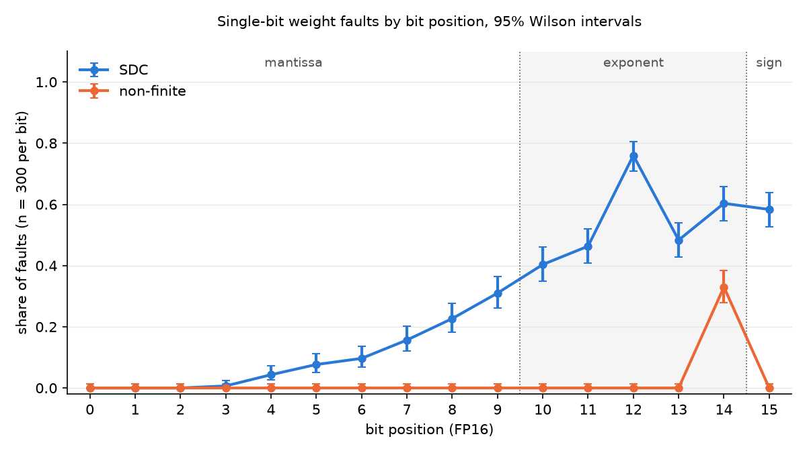

# MNIST bit-flip results (week of Nov 4 – 9, 2026)

These are the results on the hand-in list in the team doc ("Tasks (Nov 4 – Nov 9)", "What to hand in"). The fault-model paragraph and the short answers are handed in separately.

## Setup

| | |
|---|---|
| Network | Fully connected, 784 → 128 (ReLU) → 10; 101,770 parameters, 138 of them biases |
| Training | CPU, FP32; Adam (learning rate 0.001), batch size 64, 10 epochs, cross-entropy loss |
| Input scaling | `(pixel / 255 − 0.1307) / 0.3081` |
| Where faults were tested | FP16 on the Mac GPU (Apple M5 Pro, PyTorch MPS backend) |
| Faults | 150 elements from `fc1.weight` (128 × 784) and 150 from `fc2.weight` (10 × 128), each with all 16 bits flipped one at a time: 4,800 single-bit faults. Biases not faulted. |
| Reference | The same network in FP16 with no fault, on all 10,000 MNIST test images |
| Classes | Checked in this order: non-finite (any output is inf or NaN), silent data corruption or SDC (all outputs finite, at least one prediction differs from the reference), masked (every prediction equals the reference) |

## 1. Repository and reproduction

- **Repository:** https://github.com/Tonylai2789/bitflip-diffusion (this work is in `mnist/`).
- **Code version:** every official run was made at commit `757c67a` with a clean working tree. Each run folder's `run.json` records the commit.
- **Master seed:** `20261104`. Each purpose gets its own stream, derived with numpy `SeedSequence(master_seed, spawn_key=(role,))`:

  | Role | Purpose | Derived seed |
  |---|---|---|
  | 0 | Training | 3501612813 |
  | 1 | Choosing the step 4 weight | 1608880895 |
  | 2 | Sampling `fc1.weight` | 2531023520 |
  | 3 | Sampling `fc2.weight` | 4077134792 |

- **Machine:** Apple M5 Pro, macOS 26.6.2.
- **Software:** Python 3.12.16, torch 2.15.0, torchvision 0.29.2, numpy 2.5.4. Pinned in [`requirements-mac.txt`](requirements-mac.txt).
- **Commands that reproduce every table**, run from `mnist/` after `pip install -r requirements-mac.txt`:

  ```bash
  python src/mnist_fault.py train --run-name train_a
  python src/mnist_fault.py one-weight --model logs/train_a/model_fp32.pt --run-name one_weight
  python src/mnist_fault.py campaign --model logs/train_a/model_fp32.pt --run-name campaign_a
  python src/mnist_fault.py summarize logs/campaign_a
  ```

  The full list, including the repeat runs and the tests, is in [`README.md`](README.md#how-to-run-it).

## 2. Accuracy without faults

| Setting | Accuracy on 10,000 test images |
|---|---|
| FP32, CPU | 97.43% |
| FP32, Mac GPU | 97.43% |
| FP16, Mac GPU (the reference) | 97.43% |

Switching to FP16 changed accuracy by 0.0 percentage points (the margin we set was 0.1 points). Two evaluations of the fault-free FP16 network gave identical outputs.

**Sanity check:** flipping bit 14 of `fc1.weight[89696]` (-0.9482421875 → -62,144.0) changed 5,165 predictions (accuracy 46.85%). After the restore, the outputs and the fingerprint matched the fault-free network again.

## 3. Identical reruns

**Two runs of the campaign with the same master seed gave byte-identical result files** ([`logs/campaign_compare.json`](logs/campaign_compare.json)):

| File | SHA-256 (both runs) |
|---|---|
| `chosen_elements.csv` | `80e9c4669122e5da5a9a056083b20bce5988c57ca7a5282c87907bb095ba50ce` |
| `faults.csv` | `dae4fa9f643e6b19930a0fade5436df38005e17d2cbbea61d2d22de5ee52ab2e` |

Training twice also gave identical weights: parameter SHA-256 `4ee3056c93ccf1a2a56df7879c3f79464253091babe1bf913ff287c5531db923` ([`logs/train_compare.json`](logs/train_compare.json)).

## 4. One weight through all 16 bits (step 4)

The weight is `fc1.weight[33719]` (hidden unit 43, pixel 7), value `0.0166168212890625`. It was drawn from `fc1.weight` with its own seeded stream; the first draw already had magnitude below 1. Each bit was flipped, evaluated and restored before the next. File: [`logs/one_weight/one_weight.csv`](logs/one_weight/one_weight.csv).

| Bit | Field | New value | Class | Accuracy |
|---|---|---|---|---|
| 0 | mantissa | 0.0166015625 | masked | 97.43% |
| 1 | mantissa | 0.0166473388671875 | masked | 97.43% |
| 2 | mantissa | 0.0166778564453125 | masked | 97.43% |
| 3 | mantissa | 0.0167388916015625 | masked | 97.43% |
| 4 | mantissa | 0.0168609619140625 | masked | 97.43% |
| 5 | mantissa | 0.0171051025390625 | masked | 97.43% |
| 6 | mantissa | 0.0156402587890625 | masked | 97.43% |
| 7 | mantissa | 0.0185699462890625 | masked | 97.43% |
| 8 | mantissa | 0.0205230712890625 | masked | 97.43% |
| 9 | mantissa | 0.0244293212890625 | masked | 97.43% |
| 10 | exponent | 0.00830841064453125 | masked | 97.43% |
| 11 | exponent | 0.06646728515625 | masked | 97.43% |
| 12 | exponent | 0.265869140625 | masked | 97.43% |
| 13 | exponent | 6.490945816040039e-05 | masked | 97.43% |
| 14 | exponent | 1089.0 | SDC | 97.44% |
| 15 | sign | -0.0166168212890625 | masked | 97.43% |

## 5. Campaign: chosen elements and one row per fault (step 5)

- **The 300 chosen elements:** [`logs/campaign_a/chosen_elements.csv`](logs/campaign_a/chosen_elements.csv) (tensor, element index, original value).
- **One row per fault:** [`logs/campaign_a/faults.csv`](logs/campaign_a/faults.csv), 4,800 rows (tensor, element index, bit, original value, new value, class, accuracy).
- **Totals:** 3,437 masked (71.6%), 1,264 SDC (26.3%), 99 non-finite (2.1%).

## 6. Per-bit table and plot (step 6)

Each bit position has 300 faults. Each cell is the count, then the share with its 95% Wilson confidence interval. File: [`logs/campaign_a/per_bit.csv`](logs/campaign_a/per_bit.csv).

| Bit | Field | Masked | SDC | Non-finite |
|---|---|---|---|---|
| 0 | mantissa | 300 (100.0% [98.7, 100.0]) | 0 (0.0% [0.0, 1.3]) | 0 (0.0% [0.0, 1.3]) |
| 1 | mantissa | 300 (100.0% [98.7, 100.0]) | 0 (0.0% [0.0, 1.3]) | 0 (0.0% [0.0, 1.3]) |
| 2 | mantissa | 300 (100.0% [98.7, 100.0]) | 0 (0.0% [0.0, 1.3]) | 0 (0.0% [0.0, 1.3]) |
| 3 | mantissa | 298 (99.3% [97.6, 99.8]) | 2 (0.7% [0.2, 2.4]) | 0 (0.0% [0.0, 1.3]) |
| 4 | mantissa | 287 (95.7% [92.7, 97.5]) | 13 (4.3% [2.5, 7.3]) | 0 (0.0% [0.0, 1.3]) |
| 5 | mantissa | 277 (92.3% [88.8, 94.8]) | 23 (7.7% [5.2, 11.2]) | 0 (0.0% [0.0, 1.3]) |
| 6 | mantissa | 271 (90.3% [86.5, 93.2]) | 29 (9.7% [6.8, 13.5]) | 0 (0.0% [0.0, 1.3]) |
| 7 | mantissa | 253 (84.3% [79.8, 88.0]) | 47 (15.7% [12.0, 20.2]) | 0 (0.0% [0.0, 1.3]) |
| 8 | mantissa | 232 (77.3% [72.3, 81.7]) | 68 (22.7% [18.3, 27.7]) | 0 (0.0% [0.0, 1.3]) |
| 9 | mantissa | 207 (69.0% [63.6, 74.0]) | 93 (31.0% [26.0, 36.4]) | 0 (0.0% [0.0, 1.3]) |
| 10 | exponent | 179 (59.7% [54.0, 65.1]) | 121 (40.3% [34.9, 46.0]) | 0 (0.0% [0.0, 1.3]) |
| 11 | exponent | 161 (53.7% [48.0, 59.2]) | 139 (46.3% [40.8, 52.0]) | 0 (0.0% [0.0, 1.3]) |
| 12 | exponent | 72 (24.0% [19.5, 29.1]) | 228 (76.0% [70.9, 80.5]) | 0 (0.0% [0.0, 1.3]) |
| 13 | exponent | 155 (51.7% [46.0, 57.3]) | 145 (48.3% [42.7, 54.0]) | 0 (0.0% [0.0, 1.3]) |
| 14 | exponent | 20 (6.7% [4.4, 10.1]) | 181 (60.3% [54.7, 65.7]) | 99 (33.0% [27.9, 38.5]) |
| 15 | sign | 125 (41.7% [36.2, 47.3]) | 175 (58.3% [52.7, 63.8]) | 0 (0.0% [0.0, 1.3]) |

**By field** ([`logs/campaign_a/per_field.csv`](logs/campaign_a/per_field.csv)):

| Field | Faults | Masked | SDC | Non-finite |
|---|---|---|---|---|
| sign | 300 | 125 (41.7% [36.2, 47.3]) | 175 (58.3% [52.7, 63.8]) | 0 (0.0% [0.0, 1.3]) |
| exponent | 1,500 | 587 (39.1% [36.7, 41.6]) | 814 (54.3% [51.7, 56.8]) | 99 (6.6% [5.5, 8.0]) |
| mantissa | 3,000 | 2,725 (90.8% [89.7, 91.8]) | 275 (9.2% [8.2, 10.3]) | 0 (0.0% [0.0, 0.1]) |

The same 300 elements are reused for every bit, so faults within a field aren't independent; the field intervals treat them as if they were.



## Notes on reading the results

- The class compares each prediction with the fault-free FP16 network's prediction. The accuracy column compares with the true labels, so an SDC fault can leave accuracy unchanged or even raise it.
- When outputs contain NaN, the predicted class is arbitrary, so accuracy on non-finite rows isn't meaningful.
- The device that runs the network can affect whether a large fault ends as non-finite or SDC, so these results are specific to the Mac GPU.

## Open questions for Parnian

- Is the input scaling above (mean 0.1307, std 0.3081) the one to use, so that both students' results compare?
- Is a 0.1 percentage point margin for the FP16 switch acceptable?
