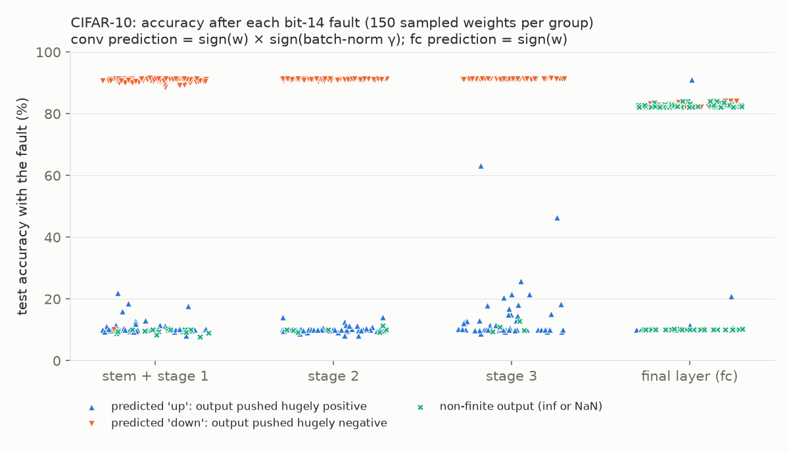
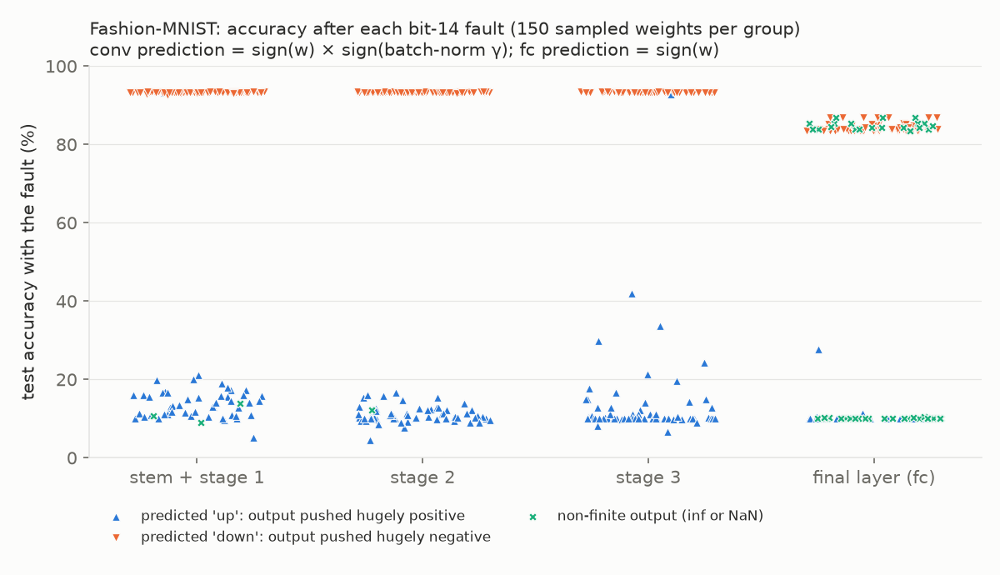

# Where the damage comes from: ResNet-20 bit-flip faults (Nov 23, 2026)

This note explains *why* the damaging faults in our Week 2 campaigns sit where they do: almost all in bit 14, and disproportionately in the final layer (`fc`). It uses the same sampled campaigns as [`results-2026-11-20.md`](results-2026-11-20.md) (`logs/fmnist_campaign_a`, `logs/cifar10_campaign_a`: 600 weights × 16 bits = 9,600 faults per dataset, each run on all 10,000 test images).

Every number here is printed by [`src/analyze_damage.py`](src/analyze_damage.py). It takes `faults.csv` paths, so it can be rerun unchanged on the exhaustive run when that finishes (section 7).

**Words used:**

- **SDC:** all output scores finite, but at least one prediction changed.
- **Large SDC:** SDC where accuracy fell by more than 0.1 pp (more than 10 of 10,000 images).
- **Damaging:** a large SDC or a non-finite output. This is the same definition as `make_figures.py`.
- **Intervals in [brackets]:** 95% bootstrap intervals, resampling *weights* rather than single faults. The 16 bit-flips of one weight are not independent, so this gives honest (wider) intervals.

## The short answers

1. **Layer size doesn't explain fragility.** Within the convolutions, smaller tensors have more SDC, but small tensors are also the early ones, so size and depth can't be separated. Where size *can* be separated from depth (the half-size first conv of stage 2 and stage 3), there is no consistent effect on damage. Per-tensor numbers rest on 10–34 sampled weights (only 1–3 for the stem conv) and have intervals of several points.
2. **Damage is rare, and it is nearly all bit 14.** 390 of 9,600 faults (4.1%) on Fashion-MNIST and 600 (6.3%) on CIFAR-10 are damaging. Bit 14 causes 93% and 79% of them. No mantissa fault (bits 0–9) was damaging. Weighted by real layer sizes, about **3.1% (Fashion-MNIST) and 4.3% (CIFAR-10) of all possible faults** do damage. About two-thirds to three-quarters of those sit in stage 3, because it holds 76% of the weights. `fc` holds 0.5% of them.
3. **Bit 14's all-or-nothing damage is predicted by one sign.** Bit 14 multiplies a weight by 65,536 (it was 0 in every sampled weight with |w| < 1). In a convolution, the following batch norm and ReLU then either pass the huge value on or zero it out. Which one happens is set by **sign(w) × sign(batch-norm γ)**. On "up" faults accuracy collapses: 379 of 383 fell by more than 50 pp or went non-finite. On "down" faults it barely moves: none of 513 fell by more than 5 pp.
4. **fc stands out on how *often* it is damaged, not how *badly*.** Every bit-14 fault in `fc` was damaging (150 of 150, both datasets). fc also gives 93% and 79% of all non-finite outputs. The reason is that nothing after `fc` can absorb the change: there's no ReLU, and its output *is* the class score. One line of arithmetic, "class c's score changes by (w_new − w) × a_j", predicts the class of all 150 fc bit-14 faults on both datasets, and their accuracy to within one image. Most of fc's non-finite outputs are an FP16 overflow of that score (50 of 54 and 96 of 101), not a NaN weight (4 and 5).

## 1. Does layer size matter?

**By group.** The groups differ in size by a factor of up to 300. SDC falls from the input side through stage 3. The damaging share is flat on Fashion-MNIST and falls with depth on CIFAR-10. `fc` is the smallest group and is at or near the top on damage.

| Group | Weights | F-MNIST SDC % | F-MNIST damaging % | CIFAR-10 SDC % | CIFAR-10 damaging % |
|---|---|---|---|---|---|
| stem + stage 1 | 13,968 / 14,256 | 63.2 [61.1, 65.2] | 3.2 [2.7, 3.8] | 85.5 [83.4, 87.5] | 7.8 [6.9, 9.0] |
| stage 2 | 50,688 | 59.7 [57.5, 61.8] | 2.8 [2.3, 3.4] | 75.5 [73.2, 77.6] | 5.5 [5.0, 6.1] |
| stage 3 | 202,752 | 29.2 [26.8, 31.8] | 3.1 [2.6, 3.7] | 47.1 [44.2, 49.9] | 3.7 [3.1, 4.3] |
| final layer `fc` | 640 | 36.5 [33.7, 39.1] | 7.0 [6.6, 7.5] | 49.1 [46.7, 51.6] | 7.9 [7.2, 8.8] |

**By tensor.** Weights were drawn uniformly within each group, so each tensor got about 150 × (its size / group size) of them. That is 10–34 per tensor, but only **1** (Fashion-MNIST) and **3** (CIFAR-10) for the stem `conv1`. Treat its row as anecdote.

| Tensor | Size | Sampled weights (F / C) | F-MNIST SDC % | F-MNIST damaging % | CIFAR-10 SDC % | CIFAR-10 damaging % |
|---|---|---|---|---|---|---|
| conv1 (stem) | 144 / 432 | 1 / 3 | 87.5 [no interval] | 6.2 [no interval] | 91.7 [81.2, 100] | 18.8 [6.2, 37.5] |
| layer1.0.conv1 | 2,304 | 26 / 28 | 61.3 [56.5, 66.6] | 1.4 [0.5, 2.4] | 86.2 [81.5, 90.4] | 9.4 [6.7, 12.5] |
| layer1.0.conv2 | 2,304 | 23 / 19 | 67.4 [62.5, 72.0] | 4.9 [3.5, 6.2] | 87.2 [83.6, 90.5] | 8.2 [6.9, 9.5] |
| layer1.1.conv1 | 2,304 | 18 / 19 | 63.2 [58.0, 68.4] | 3.1 [1.7, 4.5] | 89.8 [85.2, 93.8] | 5.6 [3.3, 7.9] |
| layer1.1.conv2 | 2,304 | 23 / 23 | 61.4 [55.7, 67.4] | 3.8 [2.4, 5.2] | 86.4 [81.0, 91.0] | 6.5 [4.9, 8.4] |
| layer1.2.conv1 | 2,304 | 34 / 33 | 64.7 [61.2, 68.2] | 2.8 [1.7, 3.9] | 81.4 [75.2, 86.9] | 8.9 [6.6, 11.7] |
| layer1.2.conv2 | 2,304 | 25 / 25 | 59.8 [54.2, 65.5] | 3.8 [2.5, 4.8] | 84.0 [80.5, 87.5] | 6.0 [5.0, 6.8] |
| layer2.0.conv1 | 4,608 | 15 / 15 | 67.1 [60.4, 73.3] | 2.5 [0.8, 4.6] | 82.1 [77.1, 87.1] | 8.8 [7.1, 10.4] |
| layer2.0.conv2 | 9,216 | 28 / 28 | 61.8 [56.7, 67.0] | 3.3 [2.2, 4.5] | 80.6 [77.2, 83.9] | 5.1 [3.6, 6.5] |
| layer2.1.conv1 | 9,216 | 22 / 22 | 62.8 [57.4, 67.6] | 2.0 [0.9, 3.1] | 79.3 [75.0, 83.2] | 5.7 [4.0, 7.4] |
| layer2.1.conv2 | 9,216 | 31 / 31 | 58.7 [54.6, 62.7] | 3.0 [1.8, 4.0] | 74.6 [70.2, 79.0] | 5.6 [4.6, 6.9] |
| layer2.2.conv1 | 9,216 | 30 / 30 | 56.5 [51.7, 61.5] | 3.1 [1.9, 4.6] | 76.2 [70.8, 81.5] | 4.4 [3.1, 5.6] |
| layer2.2.conv2 | 9,216 | 24 / 24 | 54.9 [50.0, 59.6] | 2.6 [1.6, 3.9] | 62.0 [56.5, 67.2] | 5.2 [3.9, 6.5] |
| layer3.0.conv1 | 18,432 | 10 / 10 | 53.8 [45.0, 61.3] | 3.1 [0.6, 5.6] | 61.9 [53.8, 69.4] | 4.4 [1.9, 6.9] |
| layer3.0.conv2 | 36,864 | 27 / 27 | 36.8 [32.4, 41.9] | 3.2 [2.1, 4.4] | 53.7 [48.1, 59.3] | 4.6 [3.5, 5.8] |
| layer3.1.conv1 | 36,864 | 26 / 26 | 38.5 [33.4, 43.5] | 1.9 [1.0, 3.1] | 55.5 [50.7, 60.3] | 4.3 [3.1, 5.5] |
| layer3.1.conv2 | 36,864 | 24 / 24 | 25.3 [20.8, 29.4] | 3.6 [2.3, 4.9] | 52.9 [45.8, 59.6] | 4.7 [3.1, 6.2] |
| layer3.2.conv1 | 36,864 | 29 / 29 | 20.0 [17.2, 23.1] | 3.4 [2.2, 5.0] | 45.7 [39.9, 51.3] | 3.0 [1.7, 4.3] |
| layer3.2.conv2 | 36,864 | 34 / 34 | 19.5 [16.2, 23.2] | 3.3 [2.2, 4.4] | 28.1 [24.1, 32.2] | 2.2 [1.3, 3.1] |
| fc | 640 | 150 / 150 | 36.5 [33.9, 39.2] | 7.0 [6.6, 7.5] | 49.1 [46.8, 51.7] | 7.9 [7.2, 8.7] |

**How strong is the link?** Spearman rank correlation between tensor size and share, over the 19 conv tensors:

| | Fashion-MNIST | CIFAR-10 |
|---|---|---|
| size vs SDC share | −0.86 | −0.96 |
| size vs damaging share | −0.18 | −0.88 |

**Why this isn't a size effect.** In ResNet-20, size and depth move together: every stage doubles the channels, so tensors grow 4× per stage. The early layers are both small *and* see the most pixel positions. The results write-up (section 6) already explains early-layer SDC by "touches every pixel". The one place where size changes with depth held fixed is the first conv of stages 2 and 3 (`layerN.0.conv1`), which has half the weights of its neighbours:

| | F-MNIST damaging %: half-size conv | F-MNIST: other convs | CIFAR-10: half-size conv | CIFAR-10: other convs |
|---|---|---|---|---|
| stage 2 | 2.5 [0.8, 4.6] | 2.9 [2.3, 3.4] | 8.8 [7.1, 10.0] | 5.2 [4.5, 5.8] |
| stage 3 | 3.1 [0.6, 5.6] | 3.1 [2.6, 3.7] | 4.4 [1.9, 6.9] | 3.7 [3.1, 4.2] |

Only one of the four comparisons differs (CIFAR-10, stage 2). That conv is also the stride-2 one that changes resolution, so it isn't a clean size test either. **Conclusion:** the data don't support "smaller layers are more fragile" as a rule. What makes a fault damaging (sections 3–4) is the weight's sign, the batch-norm sign after it, and whether a ReLU follows. None of these depends on layer size. `fc` is both the smallest and the last layer, and section 4 shows that being last is what matters.

**Why per-tensor damaging shares jump around.** A tensor's damaging share is mostly "what fraction of its few sampled weights happened to have sign(w) × sign(γ) > 0" (section 3), divided by 16. With ~25 weights that fraction is a coin-flip count, so neighbouring tensors differ by a few points (Fashion-MNIST `layer1.0.conv1` 1.4% vs `layer1.0.conv2` 4.9%) without meaning much.

## 2. How many faults actually do damage?

| | Fashion-MNIST | CIFAR-10 |
|---|---|---|
| Damaging faults | **390 of 9,600 (4.1%)** | **600 of 9,600 (6.3%)** |
| … from bit 14 | 361 (93%) | 471 (79%) |
| … from bit 12 (×16 or ÷16) | 10 | 55 |
| … from bit 15 (sign) | 10 | 31 |
| … from bit 11 | 3 | 25 |
| … from bit 13 | 5 | 11 |
| … from bit 10 | 1 | 7 |
| … from bits 0–9 (mantissa) | **0** | **0** |
| Non-finite (all bit 14) | 58 | 128 |

**By group** (counts of damaging faults; each group has 2,400 faults):

| Group | F-MNIST: all | F-MNIST: bit 14 | F-MNIST: other bits | CIFAR-10: all | CIFAR-10: bit 14 | CIFAR-10: other bits |
|---|---|---|---|---|---|---|
| stem + stage 1 | 78 | 74 | 4 | 188 | 127 | 61 (49 from bits 10–13, 12 sign) |
| stage 2 | 68 | 65 | 3 | 133 | 112 | 21 |
| stage 3 | 75 | 72 | 3 | 89 | 82 | 7 |
| fc | 169 | 150 | 19 (10 sign) | 190 | 150 | 40 (17 sign) |

Per-tensor counts are in the table in section 1 and in the script output.

**Where the damaging weights are in the real network.** The campaign drew 150 weights from *each* group, so `fc` (640 weights) counted as much as stage 3 (202,752). To answer "if a random bit of a random weight flips, how likely is damage, and where?", weight each group by its real size:

| Group | Share of the network's weights | F-MNIST: share of the network's damaging faults | CIFAR-10: share of the network's damaging faults |
|---|---|---|---|
| stem + stage 1 | 5.2% / 5.3% | 5.5% | 9.7% |
| stage 2 | 18.9% | 17.4% | 24.4% |
| stage 3 | 75.6% | **76.6%** | **65.4%** |
| fc | 0.24% | 0.5% | 0.4% |
| **Network-wide damaging share** | | **3.09% [2.67, 3.50]**, ≈ 132,000 of 4,288,768 faults | **4.28% [3.82, 4.75]**, ≈ 184,000 of 4,293,376 faults |

So `fc` is the most fragile layer *per weight*, but it is too small to matter for a uniformly random fault. Most damaging faults in the real network are bit-14 flips in stage 3. The exhaustive run will give these numbers exactly.

## 3. Why bit 14 is all-or-nothing

### What bit 14 does

FP16 stores a number as sign × 2^(exponent − 15) × 1.mantissa, and bit 14 is the top exponent bit:

| Weight size | Bit 14 before | What flipping it does | Weights in these networks |
|---|---|---|---|
| \|w\| < 1 | 0 | multiplies the weight by 2^16 = 65,536 | all conv weights except a few in stem + stage 1; most of fc |
| 1 ≤ \|w\| < 2 | 0 | exponent becomes all ones → the weight becomes NaN (or inf if the mantissa is 0) | fc: 8 (F-MNIST) and 37 (CIFAR-10) of 640; stem + stage 1: 7 and 19 (all in the stem conv1 except 2 on CIFAR-10); none sampled in the convs |
| \|w\| ≥ 2 | 1 | weight shrinks by 2^16 | none |

The trained weights are small: the median |w| is 0.04–0.09 in the convolutions, 0.21 (F-MNIST) and 0.39 (CIFAR-10) in `fc`. So in practice bit 14 means "this one weight becomes tens of thousands of times bigger, with its sign kept". (One correction to the results write-up: it says bit 14 "always multiplied the weight by 65,536". That's true for every sampled conv weight, but 4 (F-MNIST) and 5 (CIFAR-10) sampled fc weights had |w| ≥ 1 and became NaN instead.)

### The outcome splits in two

Here is every bit-14 fault, by how much accuracy fell (150 per group):

| | F-MNIST: ≤ 5 pp | F-MNIST: 5–50 pp | F-MNIST: > 50 pp | F-MNIST: non-finite | CIFAR-10: ≤ 5 pp | CIFAR-10: 5–50 pp | CIFAR-10: > 50 pp | CIFAR-10: non-finite |
|---|---|---|---|---|---|---|---|---|
| stem + stage 1 | 98 | 0 | 49 | 3 | 79 | 0 | 55 | 16 |
| stage 2 | 90 | 0 | 59 | 1 | 79 | 0 | 64 | 7 |
| stage 3 | 80 | 0 | 70 | 0 | 89 | 2 | 55 | 4 |
| fc | 0 | 70 | 26 | 54 | 1 | 30 | 18 | 101 |

In the convolutions, **almost nothing lands in the middle**: a bit-14 fault either costs at most a few images or wrecks the network (accuracy near 10%, i.e. chance). The only middle band belongs to `fc` (section 4).

This also explains the "median bit-14 drop of about 9 pp" (8.97 pp on Fashion-MNIST, 8.99 pp on CIFAR-10). About 41–45% of bit-14 faults cost ≤ 5 pp and about 40–42% cost > 50 pp, so the middle of the sorted list falls in fc's ~9 pp band. **That median describes almost no conv fault.** Report bit 14 as two groups, not as a median.

### Which half a conv fault lands in: sign(w) × sign(γ)

In ResNet-20 every convolution except the stem reads the output of a ReLU, so all its inputs are ≥ 0. Suppose one weight becomes 65,536× bigger. Then the output channel it feeds gets a huge value with the **sign of the weight**, wherever the input is non-zero. Next comes batch norm. In evaluation mode, batch norm is a *fixed* scale and shift per channel (γ / √var, then + β); it doesn't renormalise anything. So a huge value stays huge, and its sign is multiplied by the **sign of γ**. Then comes a ReLU, either directly (after `conv1` of a block) or after the shortcut is added (after `conv2`):

- **"up":** sign(w) × sign(γ) > 0. A huge *positive* value passes the ReLU and floods every later layer. Prediction: the network collapses.
- **"down":** sign(w) × sign(γ) < 0. A huge *negative* value is cut to 0 by the ReLU. Prediction: that channel goes silent, and the rest of the network carries on.

Tested on every sampled conv bit-14 fault except the stem (γ read from the saved model):

| Prediction | F-MNIST: faults | F-MNIST: outcome | CIFAR-10: faults | CIFAR-10: outcome |
|---|---|---|---|---|
| "up" | 183 | **181** fell > 50 pp or went non-finite (the other 2: one ≤ 0.1 pp, one 0.1–1 pp) | 200 | **198** fell > 50 pp or went non-finite (the other 2: 20–50 pp) |
| "down" | 266 | **none** fell by 1 pp or more | 247 | **none** fell by 5 pp or more |

By group, "up" faults are 35–47% of bit-14 conv faults (Fashion-MNIST 52, 60, 71 of 149–150; CIFAR-10 68, 71, 61). That is why roughly half of each conv group's bit-14 faults are damaging. The "down" faults that still count as damaging on CIFAR-10 (56, 41 and 21 of 79, 79, 89) cost 0.1–5 pp, which is the cost of losing one channel. They are more common in early layers, which is most of why CIFAR-10's damaging share falls with depth.





**How to read the figures:** each point is one bit-14 fault, placed at the accuracy it left. Blue upward triangles are faults the sign rule calls "up"; orange downward triangles are "down"; green crosses gave a non-finite output. In the three conv columns, blue sits at the bottom (about 10%) and orange at the top (unchanged accuracy). In the fc column the split is the same, except that "down" lands at about 84% (F-MNIST) or 82% (CIFAR-10) instead of at the top.

**Tested vs untested here.** *Tested:* the sign rule predicts the outcome of 379 of 383 "up" faults and all 513 "down" faults. *Untested:* that the huge activation actually travels through the network as described, where it overflows to inf/NaN inside the network (4 and 27 conv non-finite faults, all but one "up"), and why losing a channel costs more early on. We checked only outcomes, not activations. The stem conv reads normalised pixels, which can be negative, so the rule shouldn't apply there. Indeed, 2 of the 3 CIFAR-10 stem faults were "down" yet wrecked the network.

## 4. Why the final layer (`fc`) stands out

### What fc is highest on, and what it isn't

| Measure | stem + stage 1 | stage 2 | stage 3 | **fc** |
|---|---|---|---|---|
| Bit-14 faults that are damaging (F / C) | 74 / 127 of 150 | 65 / 112 | 72 / 82 | **150 / 150** |
| Non-finite faults (F / C) | 3 / 16 | 1 / 7 | 0 / 4 | **54 / 101** |
| Damaging share, all bits (F / C) | 3.2% / 7.8% | 2.8% / 5.5% | 3.1% / 3.7% | **7.0% / 7.9%** |
| Damaging faults from bits other than 14 (F / C) | 4 / 61 | 3 / 21 | 3 / 7 | **19** / 40 |
| SDC share, all bits (F / C) | **63.2% / 85.5%** | 59.7% / 75.5% | 29.2% / 47.1% | 36.5% / 49.1% |
| Median drop of a large SDC (F / C) | 77.3 / 0.6 pp | 82.4 / 77.2 pp | **83.3 / 78.3 pp** | 9.5 / 7.2 pp |
| Worst bit-14 accuracy (F / C) | 5.1% / 7.8% | **4.6%** / 8.1% | 6.6% / 8.9% | 10.0% / 10.0% |

So `fc` is highest on **how often** a fault does damage: every bit-14 flip, and most of the non-finite outputs. It ties with stem + stage 1 on CIFAR-10's overall damaging share. It is **not** highest on how *bad* a fault is: a conv collapse takes accuracy to about 5–10%, while the typical fc damage is a 9 pp drop. It also has less SDC overall than the early layers.

### The explanation, step by step

1. **fc's input is never negative.** The 64 numbers fc reads (a_1 … a_64) are averages of ReLU outputs, so they are ≥ 0. In fact every one is > 0 for at least 99% of test images.
2. **One fc weight touches one class score.** fc.weight[c, j] connects feature j to class c. Changing it from w to w_new changes class c's score by **(w_new − w) × a_j**, for each image, and changes nothing else.
3. **Nothing comes after fc.** In a conv layer, half the bit-14 faults are made harmless by the next ReLU (section 3). fc's output goes straight to the argmax. No ReLU can zero it, and the change is in the final decision itself. (Our earlier guess was "no batch norm after fc". That's only part of it: batch norm in eval mode is a fixed scale and doesn't tame a huge value. The missing ReLU is what matters.)
4. **So the sign of w decides the outcome, and both signs hurt:**
   - **w > 0:** class c's score jumps by tens of thousands for nearly every image, so nearly every image is called class c. Accuracy becomes the share of test images that really are class c: **10%**. Logged median: 10.06% (F-MNIST), 10.13% (CIFAR-10).
   - **w < 0:** class c's score drops by tens of thousands, so class c is never predicted. Accuracy falls by about class c's share of correct answers, roughly a tenth of 93% or 91%, i.e. **about 9 pp**. Logged median accuracy: 83.9% and 82.4%. Predicted from "reference minus the correct images of class c": median miss 0.4–0.5 pp.
   - In a conv layer, the "down" case is harmless. In fc it removes a whole class. That's why fc is damaged by **150 of 150** bit-14 flips while conv groups are damaged by about half.
5. **The non-finite outputs are mostly overflow, not NaN weights.** FP16 can't hold numbers above 65,504. A bit-14 weight of 65,536 × w, times a feature a_j, overflows class c's score to ±inf as soon as **|w| × a_j ≳ 1** for some image. fc's features reach 3.1 (median of each feature's maximum; up to 6.0) on Fashion-MNIST and 4.1 (up to 7.5) on CIFAR-10. So, depending on the feature, any fc weight above roughly 0.15–0.5 overflows. Among sampled fc weights with a finite flipped value, that was a third on Fashion-MNIST (50 of 146) and two-thirds on CIFAR-10 (96 of 145). A conv weight is about 10× smaller, and its huge value passes through batch norm and mixing before reaching a score.

   | Route to fc's non-finite faults | Fashion-MNIST | CIFAR-10 |
   |---|---|---|
   | weight ≥ 1 in size → bit 14 makes the weight NaN | 4 | 5 |
   | finite weight, but the class score overflows FP16 | 50 | 96 |
   | total non-finite (logged) | **54** | **101** |
   | finite and not overflowing (all logged SDC) | 96 | 49 |

   CIFAR-10 has twice as many as Fashion-MNIST because its fc weights are larger (median |w| 0.39 vs 0.21; 37 vs 8 weights above 1) and its features are larger. Both push more faults past the overflow line. So the known fact that "bit 14 turned the 4 / 5 fc weights with |w| ≥ 1 into NaN" is correct, but it explains only 4 of 54 and 5 of 101 fc non-finite faults. The other 50 and 96 are overflow.

### Test: predict every fc fault from the clean network alone (light GPU use)

We ran the fault-free FP16 network once on the 10,000 test images, recording fc's inputs and the output scores. The scores were byte-identical to the campaign's reference (SHA-256 checked). Then, for each logged fc fault, we applied step 2 (class c's score += (w_new − w) × a_j, with ±inf beyond the FP16 limit) and compared with what the campaign logged:

| fc faults | Fashion-MNIST: class right | Fashion-MNIST: accuracy within one image | CIFAR-10: class right | CIFAR-10: accuracy within one image |
|---|---|---|---|---|
| bit 14 | **150 of 150** | **146 of 146** | **150 of 150** | **145 of 145** |
| bits 10–13 | 595 of 600 | 600 of 600 | 598 of 600 | 600 of 600 |
| bit 15 (sign) | 148 of 150 | 150 of 150 | 149 of 150 | 149 of 150 |
| bits 0–9 | 1,478 of 1,500 | 1,500 of 1,500 | 1,359 of 1,500 | 1,498 of 1,500 |

(The accuracy column leaves out the NaN-weight faults, whose accuracy depends on how argmax treats NaN.)

The few class mismatches are all masked vs SDC on tiny changes. There, rounding of a near-tied image's scores decides whether one prediction flips; our arithmetic uses the rounded reference scores. Every damaging fc fault is predicted correctly. **Conclusion (tested):** fc's behaviour is fully explained by "one weight shifts one class score by (w_new − w) × a_j, and the features are positive". This also covers fc's extra sign-bit and exponent damage (19 and 40 faults): a large fc weight flipped in sign, or ×4 or ×16, moves one class score by several units, enough to swap many images.

The three w > 0 faults that did *not* collapse to 10% had tiny weights (|w| = 0.002, 0.003 and 0.00004). Even ×65,536 they add at most 13–1,400 to a score: enough to hurt (28% and 21% accuracy), or in the smallest case almost nothing (91.1%).

## 5. Summary of what is tested and what isn't

| Claim | Status |
|---|---|
| Damaging faults: 390 / 600; 93% / 79% from bit 14; none from the mantissa | Counted from the logs |
| fc's bit-14 outcomes (class and accuracy) follow from (w_new − w) × a_j | **Tested:** 150 / 150 and 150 / 150 classes; accuracy within one image |
| fc non-finite = 4 / 5 NaN weights + 50 / 96 FP16 overflows | **Tested** (same calculation) |
| Conv bit-14 outcome follows sign(w) × sign(γ) | **Tested on outcomes:** 379 / 383 "up" collapse, 0 / 513 "down" exceed 5 pp |
| …because the huge value passes (or is cut by) the next ReLU and floods later layers | **Untested** (activations not measured) |
| Where conv faults overflow to inf/NaN inside the network | **Untested** |
| Silencing one channel costs more early in the network (CIFAR-10's depth trend) | **Untested** guess |
| Smaller layers are more fragile | **Not supported:** confounded with depth; no consistent effect with depth fixed |
| Network-wide damaging share 3.1% / 4.3%, mostly in stage 3 | Estimated from the sample; the exhaustive run will give it exactly |

## 6. What this suggests for the VGG comparison (untested)

The sign rule should carry over to any conv → batch norm → ReLU network. Without batch norm, the rule would be sign(w) alone. The fc story should hold for any network whose last layer is a linear layer reading ReLU features: every bit-14 flip there damages; positive weights collapse accuracy to chance, and negative ones delete one class. And the share of non-finite outputs should grow with the size of the final layer's weights and features.

## 7. Rerunning

From `resnet20/`, with the project's environment (`resnet20\.venv`, which has torchvision):

```
.venv\Scripts\python.exe src/analyze_damage.py logs/fmnist_campaign_a/faults.csv logs/cifar10_campaign_a/faults.csv --figures figures
```

For the exhaustive run, pass `logs/exhaustive_fmnist/faults.csv logs/exhaustive_cifar10/faults.csv`. Leave out `--figures` unless you want the plots overwritten with the exhaustive data. The script reads `run.json` next to each CSV for the fault-free accuracy, dataset and model path. Groups or tensors covered by every one of their weights are reported as **exact** (no interval). A test on a synthetic 4.3-million-row file took about 13 s, and loading it added about 250 MB on top of the ~1.6 GB that importing torch uses. The fc check needs CUDA (one forward pass); without it, that section is skipped.

## Limits

- One trained network per dataset; a retrained network has different weight signs and γ's, so different faults would land "up".
- The sampled campaign has 150 weights per group, so per-tensor numbers are noisy (section 1).
- "Damaging" uses the 0.1 pp line. Many CIFAR-10 "down" faults sit just above it (0.1–1 pp), so the damaging *share* is sensitive to that choice; the collapse/no-collapse split is not.
