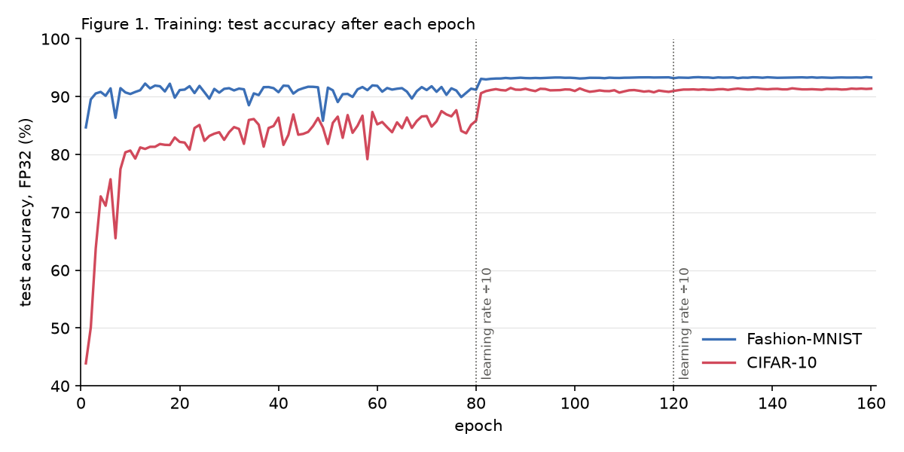
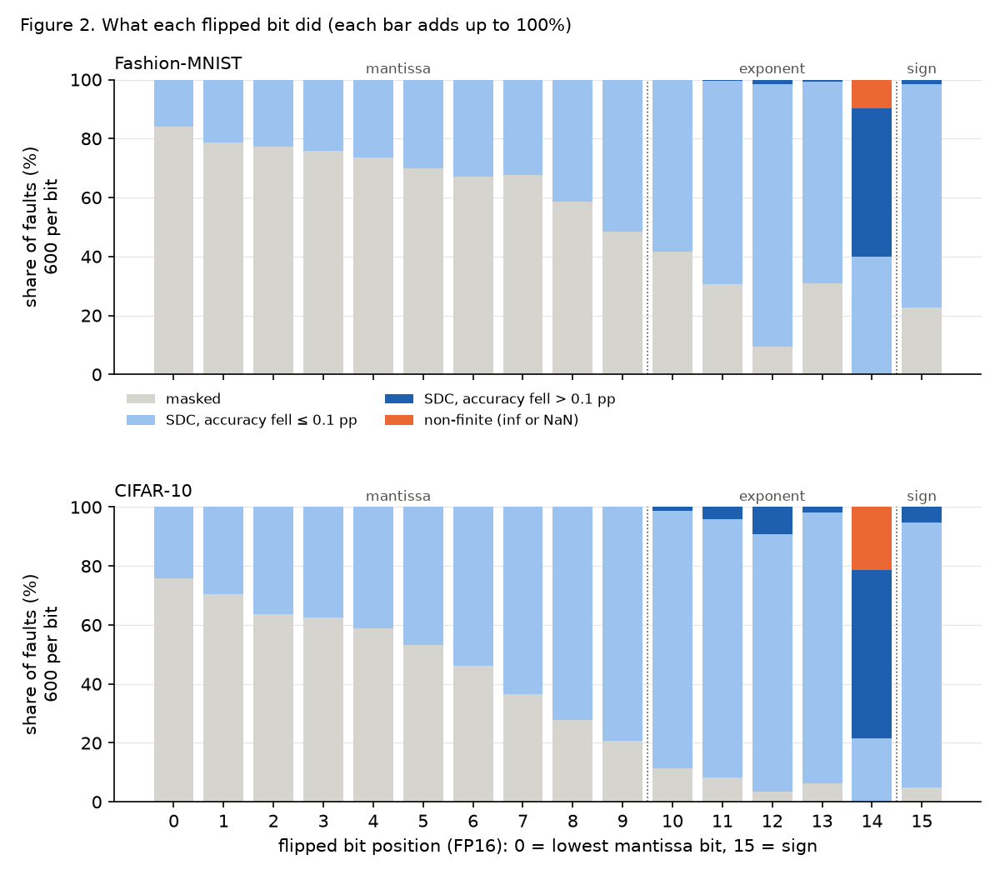
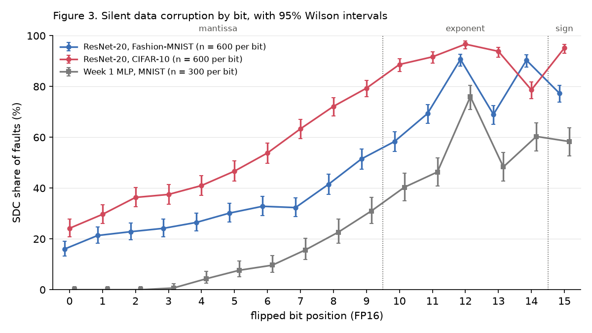
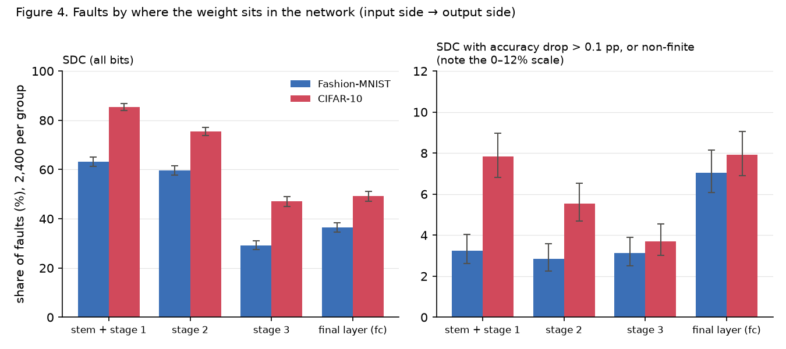
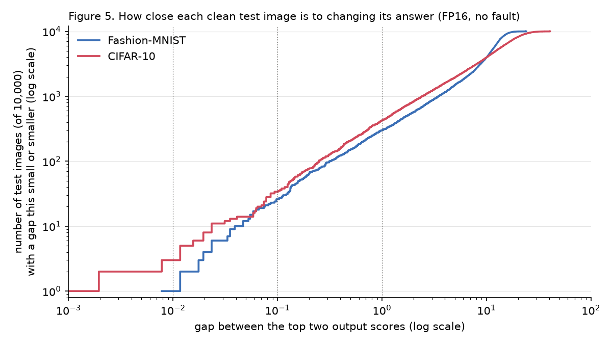

# ResNet-20 bit-flip study: results (Nov 20, 2026)

The Week 2 results for our row of the grid: ResNet-20 on Fashion-MNIST and CIFAR-10. All numbers come from the official runs at commit `27ee894` (clean tree). The logs are in [`logs/`](logs/); the figures are made from those logs by [`src/make_figures.py`](src/make_figures.py).

## Main findings

1. **About half to two-thirds of single-bit weight faults count as silent data corruption (SDC).** That's 47% of faults on Fashion-MNIST and 64% on CIFAR-10, compared with 26% for Week 1's small MNIST network.
2. **Almost all of that SDC is tiny.** In 93% (Fashion-MNIST) and 92% (CIFAR-10) of SDC faults, accuracy fell by at most 0.1 points (10 of 10,000 images), and it often went *up* by an image or two. Faults that really hurt are rare: an accuracy drop of more than 0.1 points, or a non-finite output, happened in 4.1% of faults on Fashion-MNIST and 6.3% on CIFAR-10.
3. **Bit 14, the top exponent bit, causes most of the real damage.** It is the only bit that gives non-finite outputs (inf or NaN), and it produced 93% (Fashion-MNIST) and 79% (CIFAR-10) of all damaging faults.
4. **Even the lowest bit causes SDC**, unlike Week 1, where bits 0–2 never changed a prediction. These low-bit SDCs come almost entirely from weights near the input (stem and stage 1, stage 2) and change only a few borderline test images.
5. **CIFAR-10 is more sensitive than Fashion-MNIST.** Fewer of its faults are masked at every bit and in every group of layers.
6. **Weights near the input give the most SDC**, but the **final layer gives the most non-finite outputs**.
7. **Every check passed:**
   - FP16 accuracy is within 0.1 points of FP32 on both datasets.
   - Both campaigns gave byte-identical results when run twice.
   - Every flipped weight was restored exactly.

## Setup

| | |
|---|---|
| Network | ResNet-20 (He et al., 2016, CIFAR version): a first convolution layer ("stem"), 3 stages of 3 residual blocks with 16, 32 and 64 channels, average pooling and a final linear layer (`fc`). Batch normalization after every convolution; shortcuts that pad with zeros (option A). 268,048 weights on Fashion-MNIST, 268,336 on CIFAR-10. |
| Training | FP32 on the RTX 5090. SGD with momentum 0.9 and weight decay 1e-4, learning rate 0.1 divided by 10 at epochs 80 and 120, 160 epochs, batch size 128. CIFAR-10 images get a random crop (4-pixel padding) and a random horizontal flip; Fashion-MNIST images are not augmented. |
| Input scaling | Per-channel mean and standard deviation computed from each training set. Fashion-MNIST: mean 0.2860, std 0.3530. CIFAR-10: mean (0.4914, 0.4822, 0.4465), std (0.2470, 0.2435, 0.2616). |
| Where faults were tested | The whole network in FP16 (`model.half()`) on the RTX 5090, with cuDNN set to deterministic. |
| Faults | The convolution and linear weights are split into 4 groups: stem + stage 1, stage 2, stage 3, and `fc`. From each group, 150 weights were drawn at random without repeats. Each of their 16 bits was flipped one at a time: 600 weights × 16 bits = **9,600 faults per dataset**. Biases and batch-norm values were not faulted. |
| Reference | The same FP16 network with no fault, on all 10,000 test images |
| Classes | Checked in this order. **Non-finite:** any output score is inf or NaN. **SDC:** all scores finite, and at least one of the 10,000 predictions differs from the reference. **Masked:** every prediction matches the reference. |

## How to read this report

- **Bit positions.** An FP16 number has 16 bits. Bit 15 is the **sign**. Bits 14–10 are the **exponent**: flipping one multiplies or divides the weight by 65,536 (bit 14), 256 (bit 13), 16 (bit 12), 4 (bit 11) or 2 (bit 10). Bits 9–0 are the **mantissa**: flipping one changes the weight by a fraction of itself, from about 0.05–0.1% at bit 0 up to 25–50% at bit 9. The figures mark the three fields with dotted lines.
- **Which way an exponent flip goes** depends on whether that bit was 0 (the weight gets bigger) or 1 (it gets smaller). For the 600 weights drawn on each dataset:
  - **Bit 14** was 0 in every weight. For weights smaller than 1 in size, flipping it multiplied the weight by 65,536. For the 4 (Fashion-MNIST) and 5 (CIFAR-10) sampled `fc` weights between 1 and 2 in size, it set the exponent to all ones and made the weight NaN. (Corrected Nov 24; see [`analysis-damage-2026-11-23.md`](analysis-damage-2026-11-23.md) section 3.)
  - **Bit 13** was 1 in 561 (Fashion-MNIST) and 570 (CIFAR-10) of the 600, so it usually divided by 256.
  - **Bit 12** was 0 in 388 and 320 of the 600, so it multiplied by 16 a little over half the time.
- **"pp"** means percentage points of test accuracy. On 10,000 test images, 0.01 pp is one image and 0.1 pp is ten images.
- **The brackets** after a share, like 16.0% [13.3, 19.1], are its 95% Wilson confidence interval. It shows how much the share could move with a different random draw of weights. Error bars in the figures show the same thing. When two error bars don't overlap, the difference is very unlikely to be chance.
- **"Accuracy fell"** compares a fault's accuracy with the fault-free FP16 accuracy. That is the *net* change: if one image goes wrong and another goes right, it nets to zero, even though the fault still counts as SDC. The logs don't record how many predictions changed (open question 5 in the plan).

## 1. The trained networks



**What it shows:** the FP32 test accuracy after each of the 160 training epochs, one line per dataset. The dotted lines mark epochs 80 and 120, where the learning rate is divided by 10.

**How to read it:** the line is noisy while the learning rate is high (epochs 1–80). It jumps up and flattens after each drop. A flat line at the end means training has finished, not been cut short.

**What we see:** both networks reached their final accuracy and stayed there. CIFAR-10 ends at 91.38%, close to the 91.25% reported for ResNet-20 in the original paper. Fashion-MNIST ends at 93.32%. Each training run took about 6 minutes.

Accuracy of the saved networks, measured the same way as during the fault tests (cuDNN deterministic):

| | Fashion-MNIST | CIFAR-10 |
|---|---|---|
| FP32 | 93.33% | 91.38% |
| FP16 (the reference for the faults) | 93.32% | 91.35% |
| Difference (allowed: 0.1 pp) | 0.01 pp | 0.03 pp |

Fashion-MNIST's training log says 93.32% and its evaluation says 93.33% for the same weights. The difference is one image: training lets cuDNN choose its fastest convolution method, and evaluation forces a deterministic one. The table uses the evaluation numbers.

## 2. Identical reruns

Each campaign was run twice with the same master seed (`20261104`). Both runs gave byte-identical result files ([`logs/compare_fmnist_campaign_a_vs_fmnist_campaign_b.json`](logs/compare_fmnist_campaign_a_vs_fmnist_campaign_b.json), [`logs/compare_cifar10_campaign_a_vs_cifar10_campaign_b.json`](logs/compare_cifar10_campaign_a_vs_cifar10_campaign_b.json)):

| File | Fashion-MNIST SHA-256 (both runs) | CIFAR-10 SHA-256 (both runs) |
|---|---|---|
| `chosen_elements.csv` | `ed880215…c01ea4` | `18f9e49c…358332` |
| `faults.csv` | `3eed8b18…5375cc` | `dbd501f4…34808a` |

After every fault, the flipped weight's original bits were written back. A SHA-256 fingerprint of the whole weight tensor, taken before the flip and after the restore, matched every time.

## 3. What each bit did



**What it shows:** one bar per bit position; top panel Fashion-MNIST, bottom panel CIFAR-10. Each bar is the 600 faults at that bit (one per chosen weight), split by outcome, so it adds up to 100%:

- **gray:** masked, no prediction changed
- **light blue:** SDC where accuracy fell by at most 0.1 pp (≤ 10 images), or went up
- **dark blue:** SDC where accuracy fell by more than 0.1 pp
- **orange:** non-finite

The two blues together are all SDC, as the doc defines it.

**How to read it:** read across from left to right to see how risk grows with bit position. Compare the light and dark blue to see whether a bit's SDC is harmless or harmful.

**What we see:**

- **The mantissa (bits 0–9):** gray shrinks and light blue grows steadily from bit 0 to bit 9, because each bit changes the weight twice as much as the one below it. There is essentially no dark blue: not one mantissa fault dropped accuracy by more than 0.1 pp.
- **The exponent (bits 10–14):**
  - Bits 10–13 are mostly SDC, but still mostly light blue. Doubling, halving or dividing a single weight by 256 rarely costs more than a few images.
  - Bit 12 has the most SDC (91% and 97%), because it often multiplies by 16.
  - Bit 13 has less, because it usually *divides* by 256, which nearly erases the weight rather than enlarging it.
- **Bit 14** is different from every other bit. It never masks. Half of its faults or more are damaging SDC (dark blue), and it gives all of the non-finite outputs: 9.7% of its faults on Fashion-MNIST, 21.3% on CIFAR-10. Multiplying a weight by 65,536 makes it the largest number in its layer by far.
- **The sign bit (15):** flipping it causes SDC in 77% and 95% of faults, almost all of it small.

The table gives the numbers behind the bars. SDC is shown with its 95% interval. Files: [`logs/fmnist_campaign_a/per_bit.csv`](logs/fmnist_campaign_a/per_bit.csv), [`logs/cifar10_campaign_a/per_bit.csv`](logs/cifar10_campaign_a/per_bit.csv).

| Bit | Field | F-MNIST masked % | F-MNIST SDC % | F-MNIST non-finite % | CIFAR-10 masked % | CIFAR-10 SDC % | CIFAR-10 non-finite % |
|---|---|---|---|---|---|---|---|
| 0 | mantissa | 84.0 | 16.0 [13.3, 19.1] | 0 | 75.8 | 24.2 [20.9, 27.7] | 0 |
| 1 | mantissa | 78.7 | 21.3 [18.2, 24.8] | 0 | 70.3 | 29.7 [26.2, 33.4] | 0 |
| 2 | mantissa | 77.2 | 22.8 [19.7, 26.4] | 0 | 63.7 | 36.3 [32.6, 40.3] | 0 |
| 3 | mantissa | 75.8 | 24.2 [20.9, 27.7] | 0 | 62.5 | 37.5 [33.7, 41.4] | 0 |
| 4 | mantissa | 73.5 | 26.5 [23.1, 30.2] | 0 | 59.0 | 41.0 [37.1, 45.0] | 0 |
| 5 | mantissa | 69.8 | 30.2 [26.6, 34.0] | 0 | 53.3 | 46.7 [42.7, 50.7] | 0 |
| 6 | mantissa | 67.2 | 32.8 [29.2, 36.7] | 0 | 46.2 | 53.8 [49.8, 57.8] | 0 |
| 7 | mantissa | 67.7 | 32.3 [28.7, 36.2] | 0 | 36.7 | 63.3 [59.4, 67.1] | 0 |
| 8 | mantissa | 58.5 | 41.5 [37.6, 45.5] | 0 | 27.8 | 72.2 [68.4, 75.6] | 0 |
| 9 | mantissa | 48.5 | 51.5 [47.5, 55.5] | 0 | 20.7 | 79.3 [75.9, 82.4] | 0 |
| 10 | exponent | 41.7 | 58.3 [54.3, 62.2] | 0 | 11.3 | 88.7 [85.9, 91.0] | 0 |
| 11 | exponent | 30.7 | 69.3 [65.5, 72.9] | 0 | 8.3 | 91.7 [89.2, 93.6] | 0 |
| 12 | exponent | 9.3 | 90.7 [88.1, 92.7] | 0 | 3.3 | 96.7 [94.9, 97.8] | 0 |
| 13 | exponent | 31.0 | 69.0 [65.2, 72.6] | 0 | 6.2 | 93.8 [91.6, 95.5] | 0 |
| 14 | exponent | 0.0 | 90.3 [87.7, 92.4] | 9.7 | 0.0 | 78.7 [75.2, 81.8] | 21.3 |
| 15 | sign | 22.7 | 77.3 [73.8, 80.5] | 0 | 4.8 | 95.2 [93.1, 96.6] | 0 |

**Totals:**

| | Masked | SDC, accuracy fell ≤ 0.1 pp | SDC, accuracy fell > 0.1 pp | Non-finite |
|---|---|---|---|---|
| Fashion-MNIST (9,600) | 5,017 (52.3%) | 4,193 (43.7%) | 332 (3.5%) | 58 (0.6%) |
| CIFAR-10 (9,600) | 3,300 (34.4%) | 5,700 (59.4%) | 472 (4.9%) | 128 (1.3%) |

**How bad bit 14 is:**

- **SDC from bit 14:** the median accuracy drop was 6.44 pp on Fashion-MNIST and 1.00 pp on CIFAR-10. The worst left accuracy at 4.6% and 8.1%, below the 10% of random guessing.
- **Non-finite faults:** accuracy landed either around 10% (8–14%), which is chance level, or at 82–87%, where presumably only some images' scores overflowed.

## 4. SDC by bit, compared with Week 1



**What it shows:** the share of faults that were SDC at each bit, with 95% error bars. There are three lines: ResNet-20 on Fashion-MNIST (blue), ResNet-20 on CIFAR-10 (red), and Week 1's small fully connected network on MNIST (gray, from [`../mnist/logs/campaign_a/per_bit.csv`](../mnist/logs/campaign_a/per_bit.csv)). The points are shifted sideways a little so the error bars don't overlap.

**How to read it:** a higher line means more of that bit's faults changed at least one prediction. This plot counts SDC only. Non-finite faults don't count here, which is why the bit-14 points dip where non-finite takes over (CIFAR-10 most of all). Remember that this measures how *often* a fault changes something, not how *much* it changes: section 3 shows that most of this SDC is small.

**What we see:**

- **Overall order:** CIFAR-10 is above Fashion-MNIST at almost every bit, and both are above Week 1's network.
- **The biggest gap is in the mantissa.** Week 1 had no SDC at all for bits 0–2, while ResNet-20 has 16–36%.
- **The same shape at the top bits:** all three lines peak at bit 12 and dip at bit 13, for the multiply-by-16 vs divide-by-256 reason in section 3.
- **Caution with this comparison:** the networks, datasets, number of faults per bit (600 vs 300) and GPUs (RTX 5090 vs Apple M5 Pro) all differ.

| | Week 1 MLP, MNIST | ResNet-20, Fashion-MNIST | ResNet-20, CIFAR-10 |
|---|---|---|---|
| Faults | 4,800 | 9,600 | 9,600 |
| SDC | 26.3% | 47.1% | 64.3% |
| Non-finite | 2.1% (bit 14 only) | 0.6% (bit 14 only) | 1.3% (bit 14 only) |
| Bits that never changed a prediction | 0–2 | none | none |

## 5. Where in the network the weight sits



**What it shows:** the four groups the weights were drawn from, ordered from the input side (left) to the output side (right). Each bar is the 2,400 faults in one group (150 weights × 16 bits). The left panel is all SDC. The right panel counts only the faults that did real damage: SDC that dropped accuracy by more than 0.1 pp, plus non-finite faults. **The right panel's scale only goes to 12%**, so its bars are much smaller than they look next to the left panel.

**How to read it:** compare the bar heights within a panel. The error bars are 95% intervals, and bars whose error bars don't overlap are clearly different.

**What we see:**

- **Left panel:** SDC is highest near the input and falls with depth. Fashion-MNIST: 63%, 60%, 29%, then 37% for `fc`. CIFAR-10: 86%, 75%, 47%, then 49% for `fc`.
  - A weight in the stem or stage 1 is applied at every one of the 784 (Fashion-MNIST) or 1,024 (CIFAR-10) pixel positions of every image. Even a tiny change to it touches the whole computation.
  - A stage 3 weight works on an 8 × 8 grid (7 × 7 for Fashion-MNIST).
  - An `fc` weight affects one class score.
- **Right panel:** the damaging faults are spread much more evenly. On Fashion-MNIST the final layer is clearly highest (7.0%), with the other three groups at about 3%. On CIFAR-10 the final layer and the stem + stage 1 tie at about 8%.
- **Non-finite outputs come mostly from `fc`:** 54 of 58 on Fashion-MNIST and 101 of 128 on CIFAR-10. A bit-14 flip there multiplies a weight that feeds straight into a class score, with no batch-norm layer after it. That matches Week 1, where all non-finite outputs came from the output layer.

| Group | F-MNIST SDC % | F-MNIST non-finite | CIFAR-10 SDC % | CIFAR-10 non-finite |
|---|---|---|---|---|
| stem + stage 1 | 63.2 [61.2, 65.1] | 3 | 85.5 [84.0, 86.9] | 16 |
| stage 2 | 59.7 [57.7, 61.6] | 1 | 75.5 [73.7, 77.1] | 7 |
| stage 3 | 29.2 [27.4, 31.1] | 0 | 47.1 [45.1, 49.1] | 4 |
| final layer (`fc`) | 36.5 [34.6, 38.4] | 54 | 49.1 [47.1, 51.1] | 101 |

Files: [`logs/fmnist_campaign_a/per_group.csv`](logs/fmnist_campaign_a/per_group.csv), [`logs/cifar10_campaign_a/per_group.csv`](logs/cifar10_campaign_a/per_group.csv).

## 6. Why even the lowest bit causes SDC



**What it shows:** for the fault-free FP16 network, the gap between each test image's highest and second-highest output score. It shows how close that image is to switching its answer. Both axes are logarithmic. A point (x, y) on a line means "y test images have a gap of x or less."

**How to read it:** look at the bottom-left corner. These are the images on a knife-edge: a tiny change to the network can swap their top two classes, and one swapped image is enough to make a fault SDC. The dotted lines mark gaps of 0.01, 0.1 and 1.

**What we see:**

- **Borderline images are rare but always there:**

  | | Fashion-MNIST | CIFAR-10 |
  |---|---|---|
  | Gap below 0.01 | 1 | 3 (one an exact tie) |
  | Gap below 0.1 | 26 | 34 |
  | Gap below 1 | 299 | 422 |
  | Median gap | 11.2 | 12.3 |

- **Borderline images aren't new.** Week 1's network had a similar median (12.3) and even more images below 0.01 (6). So ResNet-20's low-bit SDC is not explained by having more borderline images. What differs is how far a tiny weight change spreads.
- **Low-bit SDC comes from the layers near the input.** For bits 0–2:

  | Group | Fashion-MNIST SDC | CIFAR-10 SDC |
  |---|---|---|
  | stem + stage 1 | 200 of 450 | 299 of 450 |
  | stage 2 | 156 of 450 | 182 of 450 |
  | stage 3 | 4 of 450 | 45 of 450 |
  | `fc` | 1 of 450 | 15 of 450 |

  A small change to an early convolution weight nudges every score of every image a little. That is enough to tip the few borderline images.
- **Most borderline images are already wrong**, with the right answer in second place. In Fashion-MNIST, four of the five closest images are like this. So a tiny fault often *fixes* one image. That is why the most common SDC outcome on Fashion-MNIST is accuracy going **up** by one image (2,362 of 4,525 SDC faults).

So SDC as defined ("at least one of 10,000 predictions changed") is very sensitive in this network. It counts a fault that flips one borderline image the same as one that breaks the network. That's why section 3 separates small SDC from large. Whether to also record the number of changed predictions is open question 5 for Parnian.

## 7. One weight through all 16 bits

Each dataset's one-weight test picked one weight at random and flipped each bit in turn. Files: [`logs/fmnist_one_weight/one_weight.csv`](logs/fmnist_one_weight/one_weight.csv), [`logs/cifar10_one_weight/one_weight.csv`](logs/cifar10_one_weight/one_weight.csv).

- **Fashion-MNIST** (reference accuracy 93.32%): `layer3.1.conv1.weight[29070]` = 0.060333251953125.
- **CIFAR-10** (reference 91.35%): `layer3.1.conv1.weight[28942]` = −0.1248779296875.

| Bit | F-MNIST new value | Class | Accuracy | CIFAR-10 new value | Class | Accuracy |
|---|---|---|---|---|---|---|
| 0 | 0.060302734375 | masked | 93.32% | −0.12493896484375 | masked | 91.35% |
| 1 | 0.060394287109375 | masked | 93.32% | −0.124755859375 | SDC | 91.36% |
| 2 | 0.060455322265625 | masked | 93.32% | −0.1246337890625 | SDC | 91.36% |
| 3 | 0.060089111328125 | masked | 93.32% | −0.1243896484375 | SDC | 91.36% |
| 4 | 0.059844970703125 | masked | 93.32% | −0.1239013671875 | SDC | 91.36% |
| 5 | 0.059356689453125 | masked | 93.32% | −0.1229248046875 | SDC | 91.36% |
| 6 | 0.062286376953125 | masked | 93.32% | −0.1209716796875 | SDC | 91.36% |
| 7 | 0.056427001953125 | masked | 93.32% | −0.1170654296875 | SDC | 91.36% |
| 8 | 0.052520751953125 | masked | 93.32% | −0.1092529296875 | SDC | 91.36% |
| 9 | 0.044708251953125 | masked | 93.32% | −0.0936279296875 | SDC | 91.36% |
| 10 | 0.12066650390625 | SDC | 93.34% | −0.06243896484375 | SDC | 91.36% |
| 11 | 0.01508331298828125 | masked | 93.32% | −0.031219482421875 | SDC | 91.37% |
| 12 | 0.96533203125 | SDC | 93.30% | −1.998046875 | SDC | 91.36% |
| 13 | 0.00023567676544189453 | SDC | 93.34% | −0.0004878044128417969 | SDC | 91.35% |
| 14 | 3954.0 | SDC | 10.45% | −8184.0 | SDC | 91.26% |
| 15 | −0.060333251953125 | SDC | 93.33% | 0.1248779296875 | SDC | 91.37% |

- **The values match FP16 by hand.** For example, 0.0603 is 2⁻⁵ × 1.93, so flipping bit 14 gives 2¹¹ × 1.93 = 3,954. And −0.1249 is −2⁻⁴ × 1.998, so bit 14 gives −2¹² × 1.998 = −8,184.
- **These two weights show the whole pattern in miniature:**
  - Nearly every SDC changes accuracy by one or two images.
  - Bit 14 is the one that can wreck the network (Fashion-MNIST fell to 10.45%).
- **How much bit 14 hurts depends on the weight.** On Fashion-MNIST it wrecked the network; the CIFAR-10 weight cost only 9 images. Section 3 shows how widely the damage varies.

## 8. Limits

- **One trained network per dataset.** GPU training isn't bit-for-bit repeatable, so a second training run would give slightly different weights and somewhat different shares. The campaigns are exactly repeatable for a given saved network.
- **What was faulted:** only convolution and linear weights, one bit at a time, held in place for one pass over the test set. Batch-norm values and biases were not faulted.
- **SDC is "any prediction changed"**, so a one-image change counts the same as a collapse. Sections 3, 5 and 6 add the accuracy change to separate them. The number of changed predictions isn't recorded.
- **The 4 sampling groups** were our choice (decision D2), because the Fashion-MNIST stem has only 144 weights. Group shares are comparable to each other, but the overall totals give each group equal weight, not weight in proportion to its size. Stage 3 holds 76% of all weights but is only 25% of the faults.
- **Comparison with the VGG group:** not possible yet, because we don't have their results.

## 9. Reproduction

- **Repository:** https://github.com/Tonylai2789/bitflip-diffusion (this work is in `resnet20/`).
- **Code version:** commit `27ee894`, clean tree, recorded in every `run.json`.
- **Master seed:** `20261104`.
- **Machine:** RTX 5090 (driver 621.01), Windows 11 Pro.
- **Software:** Python 3.12.10, torch 2.15.0+cu134, torchvision 0.29.2+cu134, numpy 2.5.4. Pinned in [`requirements.txt`](requirements.txt).
- **Commands:** run from `resnet20/`. Repeat each one with `cifar10` in place of `fashion_mnist` and `fmnist`.

  ```
  .venv\Scripts\python.exe src/resnet20_fault.py train --dataset fashion_mnist --run-name fmnist_train
  .venv\Scripts\python.exe src/resnet20_fault.py one-weight --model logs/fmnist_train/model_fp32.pt --run-name fmnist_one_weight
  .venv\Scripts\python.exe src/resnet20_fault.py campaign --model logs/fmnist_train/model_fp32.pt --run-name fmnist_campaign_a
  .venv\Scripts\python.exe src/resnet20_fault.py campaign --model logs/fmnist_train/model_fp32.pt --run-name fmnist_campaign_b
  .venv\Scripts\python.exe src/resnet20_fault.py compare logs/fmnist_campaign_a logs/fmnist_campaign_b
  .venv\Scripts\python.exe src/resnet20_fault.py summarize logs/fmnist_campaign_a
  .venv\Scripts\python.exe src/make_figures.py
  ```

- **About the figure script:** `make_figures.py` needs the trained model files (`logs/*_train/model_fp32.pt`, kept out of git) for Figure 5. Before using them, it checks that the network's fault-free output scores are byte-identical to the campaign's reference. It also writes every plotted count to `figures/numbers.json`.
- **Run times on the RTX 5090:**

  | | Fashion-MNIST | CIFAR-10 |
  |---|---|---|
  | Training | 6.2 min | 5.9 min |
  | Each campaign | 4.2 min | 5.3 min |
